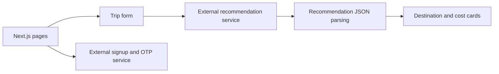

# ExploreEase

**Explore Indian destinations and request a trip recommendation from one simple form.**

ExploreEase is a Next.js travel-planning frontend with destination cards, a budget and preference form, recommendation results, and signup/OTP screens. It connects to separately hosted recommendation and authentication services.

[Get started](#get-started) · [Example](#example) · [Architecture](#architecture)

## Why this project

Choosing a destination involves several constraints at once: starting location, group size, budget, and travel preferences. ExploreEase brings those inputs together and presents the returned destination, costs, accommodation, and travel logistics in a readable layout.

## What is implemented

- Home page featuring Indian destinations and reusable cards.
- `/planning` form for budget, starting location, group size, and preference.
- Recommendation display with highlights, estimated costs, accommodation, transport, and suggested visiting periods.
- Loading and error handling around the recommendation request.
- Signup and OTP verification requests, plus about and contact pages.

## Get started

Download and extract the repository. With Node.js and npm installed, run from the root:

```bash
npm install
npm run dev
```

Open `http://localhost:3000`.

```bash
npm run build
npm start
```

## Service connections

Review the configured service URLs in [app/planning/page.tsx](app/planning/page.tsx) and [app/signin/page.tsx](app/signin/page.tsx). Backend implementations are not included in this repository.

| Workflow | Request |
| --- | --- |
| Recommendation | `POST /recommend_travel` on the recommendation service |
| Signup | `POST /api/auth/signup` on the authentication service |
| OTP verification | `POST /api/auth/verify-otp` on the authentication service |

The recommendation request includes `budget`, `starting_location`, `group_size`, and `preference_type`. The frontend expects a `recommendation` string containing JSON and parses it into the displayed result.

## Example

Open `/planning`, enter a starting city, set a budget, choose group size and preference, then submit. A compatible reachable service must return the expected response before result cards appear. The app does not include hotel reservations or payment processing.

## Architecture



## Source guide

| Path | Purpose |
| --- | --- |
| [app/page.tsx](app/page.tsx) | Home page and destination cards |
| [app/planning/page.tsx](app/planning/page.tsx) | Form, API request, and result rendering |
| [app/signin/page.tsx](app/signin/page.tsx) | Signup and OTP flow |
| [components](components) | Header, footer, and shared UI |
| [next.config.mjs](next.config.mjs) | Next.js configuration |

## Development notes

The frontend uses Next.js, React, TypeScript, Tailwind CSS, and Lucide icons. Video is rendered through an HTML video element. Verify the service contract when changing the recommendation UI; the hard-coded external URLs are not an availability guarantee. The login flow includes unfinished code, so treat authentication as an integration prototype.

Contributions can focus on clearer errors, response validation, responsive layouts, and connecting the unfinished flows. The earlier README referred to an MIT license, but no license file is present in the current repository.
